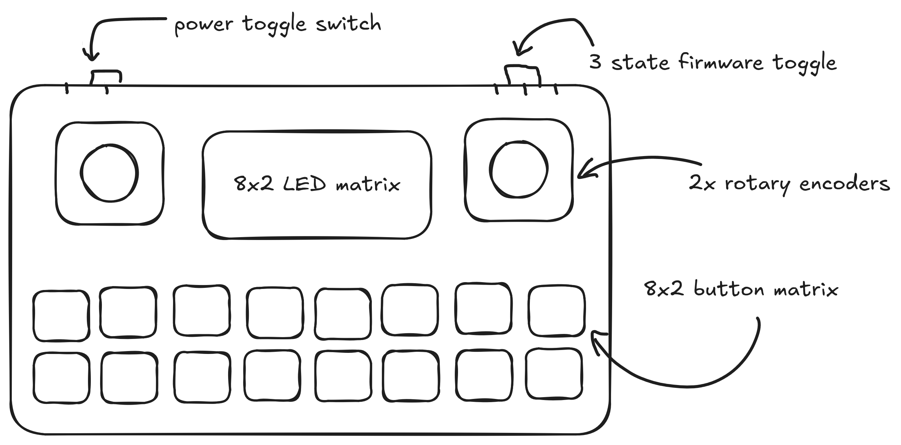

# pocket-midi



A pocket-sized MIDI controller based on the RP2350 MCU, using the Seeed Studio XIAO RP2350. Built with FreeRTOS, TinyUSB, and pico-sdk.

I've been using VCV Rack to test the MIDI interface here, check out [patches](./docs/patches/) for examples.

## dependencies
- `arm-none-eabi-gcc`
- `cmake`
- `picotool`
- pico-sdk with `PICO_SDK_PATH` set

## build
```
git submodule update --init --recursive
cmake -B build -DPICO_BOARD=seeed_xiao_rp2350
cmake --build build
```

## flash
```
picotool load -f -x build/pocket_midi.uf2
```

## stdout: serial monitor over USB
```
tio /dev/ttyACM0
```


## wiring

Pin assignments for the XIAO RP2350 and the MCP23017 GPIO expander.

### XIAO RP2350

| D-label | GPIO | use |
| --- | --- | --- |
| D0 | 26 (A0) | encoder 1 |
| D1 | 27 (A1) | encoder 1 |
| D2 | 28 (A2) | encoder 1 |
| D3 | 5 | I2C0 SCL, 100 kHz, external pull-up |
| D4 | 6 | encoder 2 |
| D5 | 7 | encoder 2 |
| D6 | 0 (TX) | UART debug |
| D7 | 1 (RX) | UART debug |
| D8 | 2 | |
| D9 | 4 | I2C0 SDA, external pull-up |
| D10 | 3 | encoder 2 |
| - | 25 | onboard LED |

I2C addresses: MCP23017 at **0x20**, IS31FL3731 LED driver at **0x74** (AD pin to GND).

### MCP23017 (DIP-28)

| pin | name | connection | buttons |
| --- | --- | --- | --- |
| 1-8 | GPB0-GPB7 | button to GND | 1-8 (top row) |
| 9 | VDD | 3V3, decoupling cap to VSS | |
| 10 | VSS | GND | |
| 11 | NC | - | |
| 12 | SCK | XIAO D3 / GPIO5 | |
| 13 | SDA | XIAO D9 / GPIO4 | |
| 14 | NC | - | |
| 15-17 | A0-A2 | GND | |
| 18 | RESET | pulled high to 3V3 (active low) | |
| 21-28 | GPA0-GPA7 | button to GND | 9-16 (bottom row) |
